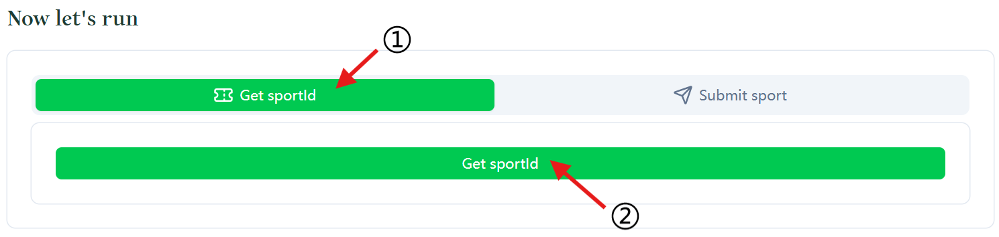
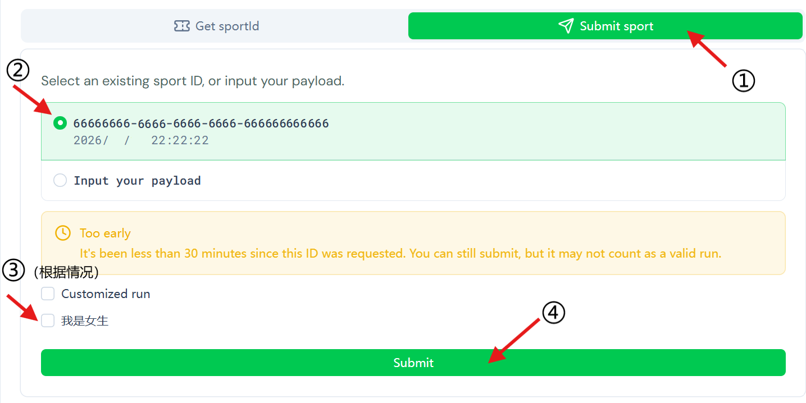

考虑到大家课业繁重，学无余力，而且校园跑次数挺多的，还是推荐几个“好好”完成校园跑的方法。

# 免责声明
为进一步提高锻炼的实效性，切实提高学生体质健康水平，倡导求是诚信锻炼，严禁骑自行车替代跑步锻炼等违规行为。自本办法实施始，将对不诚信锻炼行为予以严肃处理。 
第1次被认定违规锻炼的，扣除课外锻炼次数3次。第2次被认定违规锻炼的，扣除课外锻炼次数6次。第3次被认定违规锻炼的，本学期体育课成绩认定为不及格。对被认定的不诚信锻炼行为，可在浙大体艺App后台进行申诉。————浙大体艺《考核标准》

既然选择使用，也要承担相应的风险！

# 具体方法
## 场馆划水法（唯一官方认可的方法）
1.有效时长：30分钟-120分钟。**刷入后记得要刷出，一定一定一定不要超时** 
2.有效时段：各场馆对外开放时间。 
3.紫金港校区场馆：紫金港校区风雨操场、健身房（游泳馆1楼）、游泳馆、风雨操场旁边的五人制足球场地、西区足球场、银泉健身房、玉湖健身房。

院（园）系体育活动累计次数最高可以计12次。

## 定位漂移法
### 操作方法
可在下拉菜单关闭定位：打开浙大体艺，开始跑步➡️关闭手机定位➡️等待8s左右➡️打开手机定位➡️欣赏独特的路线（**等待定位稳定后**重复若干次）

只能在设置关闭定位：打开浙大体艺，开始跑步➡️打开设置，关闭手机定位➡️在设置内等待8s左右➡️在设置内打开手机定位➡️在设置内等待两三秒➡️切换回浙大体艺，欣赏独特的路线（**等待定位稳定后**重复若干次）

### 原理解释
在跑步过程中，先关闭手机的定位，当定位重新被打开时，并不会精准的定位到手机位置，会有几十米的偏差，在几秒之内会校准。校准过程中的定位跳跃也被记录到我们的跑步路径中，校准时间短保证了瞬时速度远超十分钟配速，最终达到以小博大、以走代跑的效果，“跑步”速度主要取决于漂移程度和开关定位的频率，**不要太频繁**，速度超过25KM/H，路径会被标记为黄色，表示无效。还有**不要太靠近区域边界**，漂移出边界的路线同样无效。

Deepseek给的专业解释：多种定位技术（GPS、Wi-Fi/基站、传感器）在强制重启后，各自的“启动时间线”不一致所导致的短暂混乱。系统可能先返回了缓存的旧位置或过时的网络定位结果，同时GPS和传感器还在后台努力“找回状态”。

## 虚拟定位法
所谓苹果手机（iOS）的专属福利。Android 理论上可行，但可能要 Root（v.获取最高权限）你的手机，或者自行寻找无需 root 的工具。

### 操作方法（iOS）
[iOSRealRun-cli](https://github.com/sijunpeng123/iOSRealRun-cli) 
[ZJU_FakeRun](https://github.com/laiang04/ZJU_FakeRun) 
[EdgeRunners](https://github.com/simymuero/EdgeRunners)
[vloc 虚拟定位](https://github.com/free-as-bird/blog/releases/download/volc/vloc-portable.zip) 
[iOSRealRun-cli-18](https://github.com/BiancoChiu/iOSRealRun-cli-18) 
爱思助手……

此类工具还有很多，大概率要打开 iOS 的开发者模式，这里仅列举了几个，可用性与 iOS 版本相关。

### 原理解释
Apple 官方为开发者和测试场景预留了“位置模拟”的合法通道，一些工具可以利用 iOS 系统开发者服务，通过 USB 或本机配对的方式，向系统发送模拟坐标指令，从而让系统向所有 App 报告一个虚假位置。这种方式不需要越狱，也不需要安装证书，但通常需要连接电脑或开启开发者模式。

## 一键式方法
Tired of the iOS lock-in of RealRun? Then switch to NeverRun.
### 操作方法（iOS）
1、打开 [NeverRun](https://run.alabtnt.cn/#/first-time) 网站 
2、在 **ZJU Username** 框里输入自己浙大通行证的账号（就是学号），在 **Password** 框里输入浙大通行证的的密码，完成后点击绿色的 **Save** 按钮 
3、耐心等待，直到屏幕上出现你的信息，格式如下

    Is it you?
    Then everything you provided seems OK to us.

    xh    XXXXXXXXXX
    xm    XXX
    xymc  X学院

核对无误后点击 **continue** 
4、在 **Get sportId** 栏目下点击 **Get sportId** 按钮 

5、等待30分钟左右,期间可以离开浏览器，但**不要**清理浏览数据，不然要重新登录，而且前面获取的 ID 会丢失 
6、切换到 **Submit sport** 栏目，如果为女生请勾选 **我是女生**，如果想要自定义跑步速度等请勾选 Customized run（没必要） 

7、点击下方 **Submit** 按钮

### 原理解释
自行阅读 https://run.alabtnt.cn/#/about

这里就解释一下为什么要等待30分钟 
众所周知，校园跑要求10分钟内跑完一公里，三公里就是30分钟以内完成。你获取 sportId 的时间就是开始“跑步”的时间，30分钟之后提交就可以保证在“跑”完之前跑步记录没有被上传，防止被系统判断为无效。

## 应急
在浙大体艺跑步过程中按屏幕右侧暂停键，可以获得1分钟时间，期间计时暂停，定位也不会动，但人可以继续跑。在继续运动的一两秒内，你会收获暂停前与暂停后两点的连线这么长的路程。 
一次暂停结束后可以再次暂停。